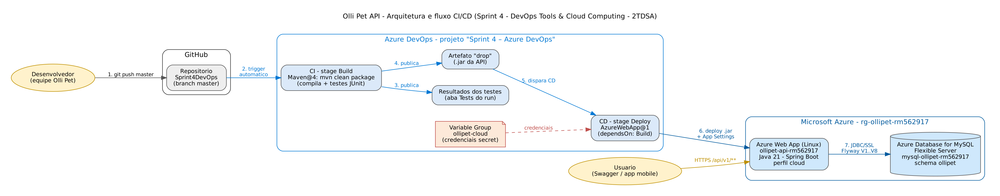

# Olli Pet API — Sprint 4: Deploy automatizado com Azure DevOps

**Challenge Clyvo · DevOps Tools & Cloud Computing · Turma 2TDSA**

API REST em Spring Boot que é o backend do aplicativo mobile da clínica veterinária
Olli Pet. Nesta sprint a API passou a ser compilada, testada e publicada
**automaticamente** na Azure por uma pipeline de CI/CD no Azure DevOps, usando um
**banco de dados MySQL em nuvem** (Azure Database for MySQL Flexible Server).

| | |
|---|---|
| **Repositório** | https://github.com/HenriqueRodriguesV/Sprint4DevOps |
| **API publicada (Swagger)** | https://ollipet-api-rm562917.azurewebsites.net/swagger-ui.html |
| **Vídeo da Sprint 4** | _adicionar o link do YouTube (não listado)_ |
| **Projeto no Azure DevOps** | https://dev.azure.com/ollipetnoite/Sprint%204%20%E2%80%93%20Azure%20DevOps |
| **PDF de entrega** | [`docs/entrega/Entrega-Sprint4-DevOps-2TDSA.pdf`](docs/entrega/Entrega-Sprint4-DevOps-2TDSA.pdf) (nomes, RMs, turma e links) |
| **Documentação técnica (PDF)** | [`docs/Sprint4-DevOps-OlliPet.pdf`](docs/Sprint4-DevOps-OlliPet.pdf) (evidências detalhadas) |
| **Repositório Java** | https://github.com/GabyBonfim/java-ollipet |
| **Repositório Mobile** | https://github.com/FIAP-MOBILE/clyvo-challenge-ollipet |

## Equipe — Turma 2TDSA

| Nome | RM |
|---|---|
| Andre Rosa Colombo | RM563112 |
| Gabriely Bonfim Silva | RM566242 |
| Henrique Rodrigues Vespasiano | RM562917 |
| Mirelly Sousa Alves | RM566299 |
| Ruan Luca Feliciano | RM562218 |

---

## Requisitos do enunciado (Sprint 4 — DevOps Tools & Cloud Computing)

| Requisito | Onde está |
|---|---|
| 1. Descrição da solução e stack | [Seção 1](#1-descrição-da-solução) e [Tecnologias](#tecnologias) |
| 2. Diagrama da arquitetura + fluxo CI/CD (componentes, ordem numerada, personas, onde cada ferramenta atua) | [Seção 2](#2-arquitetura-e-fluxo-cicd) |
| 3. Banco de dados em nuvem (PaaS) | Azure Database for MySQL Flexible Server — [Seção 3](#3-banco-de-dados-em-nuvem) |
| 4. Projeto no Azure DevOps (nome, descrição com professor e integrantes, privado, Git, Scrum) | [Seção 4.2](#42-configurar-o-projeto-no-azure-devops) |
| 5. Professor convidado com acesso Basic | Felipe Cavalcante Vilella de Oliveira (pf2128@fiap.com.br), Contributor, Basic |
| 6. Pipelines CI/CD (YAML) | [`azure-pipelines.yml`](azure-pipelines.yml) — [Seção 4.3](#43-criar-a-pipeline) |
| I. Conectada ao repositório | GitHub `HenriqueRodriguesV/Sprint4DevOps` |
| II. CI dispara a cada alteração na branch master | `trigger: master` (e `main`) |
| III. CD dispara após novo artefato | stage Deploy com `dependsOn: Build` |
| IV. Variáveis sensíveis protegidas | Variable Group `ollipet-cloud` (secret) |
| V. Artefato publicado no Azure DevOps | `PublishPipelineArtifact@1` → artefato `drop` |
| VI. Testes no CI | `Maven@4` com 30 testes JUnit publicados na aba Tests |
| VII. Deploy em Azure Web App | `AzureWebApp@1` → `ollipet-api-rm562917` |
| 8. Vídeo | Roteiro em [`docs/azure/ROTEIRO_VIDEO.md`](docs/azure/ROTEIRO_VIDEO.md) |
| PDF de entrega | [`docs/entrega/Entrega-Sprint4-DevOps-2TDSA.pdf`](docs/entrega/Entrega-Sprint4-DevOps-2TDSA.pdf) |

---

## 1. Descrição da solução

A Olli Pet resolve hoje agendamento, vacinação, triagem e acompanhamento de
tratamento por WhatsApp e planilhas. A API concentra quatro regras de negócio que
uma tela ou uma mensagem sozinha não garantem:

1. **Triagem por questionário** — classifica a urgência do pet a partir das
   respostas do tutor, cruzando idade, vacinação e histórico clínico.
2. **Agendamento de consulta** — controla a agenda dos veterinários, impede choque
   de horário e cancelamento fora do prazo.
3. **Carteira de vacinação** — calcula sozinha o número da dose e a data da próxima
   aplicação a partir do protocolo de cada vacina.
4. **Tratamento em casa** — transforma uma prescrição em doses individuais que o
   tutor confirma, medindo a adesão real ao tratamento.

**Benefícios para o negócio:** a agenda deixa de depender da recepção conferir
conflitos; a triagem funciona a qualquer hora, sem alguém no WhatsApp; a clínica vê
quem está com vacina atrasada antes de o tutor aparecer; e o veterinário passa a ver
o percentual real de doses confirmadas em vez de depender do relato do tutor.

---

## 2. Arquitetura e fluxo CI/CD



1. O desenvolvedor faz `git push` na branch `master` do GitHub.
2. O push dispara automaticamente a pipeline no Azure DevOps.
3. **CI (stage Build):** `mvn clean package` compila o projeto e roda os testes JUnit;
   os resultados aparecem na aba **Tests** do run.
4. O `.jar` é publicado como artefato `drop` no Azure DevOps.
5. **CD (stage Deploy):** começa sozinho assim que o artefato existe (`dependsOn: Build`).
6. A task `AzureWebApp@1` aplica as App Settings e publica o `.jar` no Azure Web App.
7. No boot, a API conecta no MySQL em nuvem via JDBC/SSL e o Flyway aplica as
   migrations `V1`..`V8`.

O fonte do diagrama está em [`docs/azure/arquitetura-cicd.dot`](docs/azure/arquitetura-cicd.dot).

### Detalhamento dos componentes

| Componente | Nome do recurso | Tipo | Descrição funcional | Tecnologia |
|---|---|---|---|---|
| Repositório | `HenriqueRodriguesV/Sprint4DevOps` | Repositório Git | Código-fonte, pipeline e scripts | GitHub |
| Projeto DevOps | `Sprint 4 – Azure DevOps` | Projeto Azure DevOps (privado, Git, Scrum) | Boards, pipeline, Library e environments | Azure DevOps |
| Pipeline | `azure-pipelines.yml` | Pipeline YAML multi-stage | CI (build + testes + artefato) e CD (deploy) | Azure Pipelines |
| Variable Group | `ollipet-cloud` | Library | Guarda `DATABASE_URL`, `DATASOURCE_USERNAME` e `DATASOURCE_PASSWORD` como secret | Azure Pipelines Library |
| Service Connection | `sc-ollipet-azure` | Azure Resource Manager | Autoriza a pipeline a publicar na assinatura | Azure DevOps |
| Resource Group | `rg-ollipet-rm562917` | Grupo de recursos | Agrupa todos os recursos da solução | Azure |
| App Service Plan | `plan-ollipet-rm562917` | App Service Plan Linux B1 | Capacidade computacional do Web App | Azure App Service |
| Web App | `ollipet-api-rm562917` | Web App Linux, Java 21 | Executa a API Spring Boot (perfil `cloud`) | Azure App Service |
| Banco de dados | `mysql-ollipet-rm562917` / schema `ollipet` | Azure Database for MySQL Flexible Server 8.0.21 (B1ms, Mexico Central) | Persistência relacional da aplicação | MySQL 8 + Flyway |

---

## 3. Banco de dados em nuvem

- **Local:** H2 em arquivo (`./data`), para desenvolver sem depender da nuvem.
- **Nuvem:** Azure Database for MySQL Flexible Server, ativado pelo perfil Spring
  `cloud` ([`application-cloud.properties`](src/main/resources/application-cloud.properties)).
- O schema é criado **exclusivamente pelo Flyway** (`ddl-auto=validate`). O módulo
  `flyway-mysql` está no `pom.xml`: sem ele o Flyway 10+ recusa o MySQL
  (`Unsupported Database: MySQL 8.0`).
- **DDL comentado:** [`script_bd.sql`](script_bd.sql) reúne as migrations `V1`..`V8`
  em um único arquivo. Ele foi validado em MySQL 8.0 e cria as 18 tabelas com a carga
  inicial.

Tabelas do CORE do negócio: `usuario`, `responsavel`, `med_vet`, `administrador`,
`pet`, `consulta`, `prontuario`, `vacina`, `aplicacao_vacina`, `queixa`,
`pergunta_triagem`, `opcao_resposta`, `orientacao_triagem`, `triagem`,
`resposta_triagem`, `observacao_triagem`, `tratamento` e `dose_tratamento`.

---

## 4. Passo a passo do deploy

### 4.1 Provisionar os recursos na Azure (Azure CLI)

No Azure Cloud Shell (Bash), na raiz do repositório:

```bash
export MYSQL_ADMIN_PASSWORD='<senha-forte>'   # não versionar
bash docs/azure/provisionar.sh
```

O script [`docs/azure/provisionar.sh`](docs/azure/provisionar.sh) cria, nesta ordem:

1. o Resource Group;
2. o MySQL Flexible Server e o schema `ollipet`;
3. as regras de firewall: serviços do Azure e o IP de quem roda o script, que é o que
   permite fazer o `SELECT` direto no banco;
4. o App Service Plan Linux;
5. o Web App Java 21, já com as App Settings.

A região padrão é `mexicocentral`. A assinatura Azure for Students só libera
`mexicocentral`, `chilecentral`, `eastus`, `southcentralus` e `northcentralus`, e o
MySQL Flexible B1ms só tem SKU disponível em `mexicocentral` e `chilecentral`.
O script pode ser executado de novo sem problema: o MySQL só é criado se ainda não existir.

### 4.2 Configurar o projeto no Azure DevOps

Configuração usada nesta entrega: organização **`ollipetnoite`**, projeto
**[Sprint 4 – Azure DevOps](https://dev.azure.com/ollipetnoite/Sprint%204%20%E2%80%93%20Azure%20DevOps)**.
O professor Felipe Oliveira (`pf2128@fiap.com.br`) foi convidado como **Contributor**,
com nível de acesso **Basic**.

1. Em https://dev.azure.com crie o projeto **`Sprint 4 – Azure DevOps`**:
   - Description:
     ```text
     Projeto para entrega da Sprint 4 do professor Felipe Cavalcante Vilella de Oliveira
     Integrantes do grupo:
     RM563112 - Andre Rosa Colombo - 2TDSA
     RM566242 - Gabriely Bonfim Silva - 2TDSA
     RM562917 - Henrique Rodrigues Vespasiano - 2TDSA
     RM566299 - Mirelly Sousa Alves - 2TDSA
     RM562218 - Ruan Luca Feliciano - 2TDSA
     ```
   - Visibility: **Private**;
   - Version control: **Git**;
   - Work item process: **Scrum**.
2. Convide o professor em **Project Settings → Permissions → Contributors**, com o
   nível de acesso **Basic**.
3. Crie a **Service Connection**:
   - caminho: **Project Settings → Service connections → New → Azure Resource Manager**;
   - método: Workload Identity federation, sem senha armazenada;
   - escopo: Resource Group `rg-ollipet-rm562917`;
   - nome: **`sc-ollipet-azure`**;
   - marque **Grant access permission to all pipelines**.
4. Crie o **Variable Group** em **Pipelines → Library → + Variable group**:
   - nome: **`ollipet-cloud`**;
   - variáveis abaixo, todas marcadas com o **cadeado (secret)**;
   - em **Pipeline permissions**, libere o grupo para a pipeline.

   | Variável | Valor |
   |---|---|
   | `DATABASE_URL` | `jdbc:mysql://mysql-ollipet-rm562917.mysql.database.azure.com:3306/ollipet?useSSL=true&requireSSL=true&serverTimezone=UTC` |
   | `DATASOURCE_USERNAME` | `ollipetadmin` |
   | `DATASOURCE_PASSWORD` | a senha usada no `provisionar.sh` |

### 4.3 Criar a pipeline

**Pipelines → New pipeline → GitHub → `Sprint4DevOps` → Existing Azure Pipelines YAML
file → `/azure-pipelines.yml` → Run.**

A partir daí, **todo push na `master` dispara o CI/CD sozinho**. Nenhum passo é manual.

| Stage | O que faz |
|---|---|
| **CI - Build** | `Maven@4` roda `mvn clean package` (compila + testes JUnit) e publica os resultados dos testes; `CopyFiles@2` + `PublishPipelineArtifact@1` publicam o `.jar` como artefato `drop`. |
| **CD - Deploy** | `dependsOn: Build`, portanto só começa com o artefato pronto. Roda no environment `producao-ollipet`; a task `AzureWebApp@1` aplica as App Settings (credenciais vindas do Variable Group secret) e publica o `.jar` no Web App. |

### 4.4 Remover os recursos (depois da avaliação)

```bash
bash docs/azure/limpar.sh
```

---

## 5. Testes do CRUD (tabela `pet`, relacionada a `responsavel` por `pet.id_resp`)

Base: `https://ollipet-api-rm562917.azurewebsites.net`

**Login (tutora Maria Silva):**

```http
POST /api/v1/auth/login
Content-Type: application/json

{ "email": "maria.silva@email.com", "senha": "123456" }
```

Use o `token` retornado em `Authorization: Bearer <token>` nas chamadas abaixo.

| Operação | Requisição | Conferência no banco |
|---|---|---|
| **Create** | `POST /api/v1/pets` | `SELECT id_pet, nome, raca, id_resp FROM pet ORDER BY id_pet DESC LIMIT 1;` |
| **Read** | `GET /api/v1/pets/{id}` | mesmo `SELECT` |
| **Update** | `PUT /api/v1/pets/{id}` | `SELECT id_pet, nome, descricao FROM pet WHERE id_pet = {id};` |
| **Delete** | `DELETE /api/v1/pets/{id}` → `204` | `SELECT COUNT(*) FROM pet WHERE id_pet = {id};` → `0` |

Corpo do **Create**:

```json
{
  "nome": "Bolinha",
  "descricao": "Vira-lata resgatado, muito brincalhao",
  "raca": "Vira-lata",
  "especie": "CAO",
  "dataNascimento": "2024-02-10"
}
```

Corpo do **Update**:

```json
{
  "nome": "Bolinha Castrado",
  "descricao": "Castrado em 10/2026",
  "raca": "Vira-lata",
  "especie": "CAO",
  "dataNascimento": "2024-02-10"
}
```

Para o `SELECT`, conecte no banco em nuvem (o IP precisa estar no firewall):

```bash
mysql -h mysql-ollipet-rm562917.mysql.database.azure.com -u ollipetadmin -p --ssl-mode=REQUIRED ollipet
```

---

## 6. Executar localmente

Requer **Java 21**.

```bash
./mvnw spring-boot:run          # H2 em arquivo, porta 8080
./mvnw clean package            # o mesmo build + testes que a pipeline roda
```

| Recurso | Endereço |
|---|---|
| Swagger | http://localhost:8080/swagger-ui.html |
| Console H2 | http://localhost:8080/h2-console (JDBC `jdbc:h2:file:./data/challenge_clyvo`, usuário `sa`, sem senha) |

Para rodar localmente contra um MySQL, em vez do H2:

```bash
SPRING_PROFILES_ACTIVE=cloud \
DATABASE_URL='jdbc:mysql://localhost:3306/ollipet' \
DATASOURCE_USERNAME=root DATASOURCE_PASSWORD=<senha> ./mvnw spring-boot:run
```

### Variáveis de ambiente

| Variável | Uso |
|---|---|
| `SPRING_PROFILES_ACTIVE` | `cloud` ativa o MySQL (`application-cloud.properties`) |
| `DATABASE_URL` | URL JDBC do banco |
| `DATASOURCE_USERNAME` / `DATASOURCE_PASSWORD` | credenciais do MySQL (perfil `cloud`) |
| `SERVER_PORT` / `PORT` | porta HTTP (padrão `8080`) |
| `APP_SECURITY_JWT_SECRET` | chave HMAC dos tokens emitidos pela própria API |
| `FIREBASE_PROJECT_ID` | projeto Firebase cujos ID tokens a API aceita |
| `APP_CORS_ORIGENS` | origens liberadas no CORS |

### Contas de demonstração (senha `123456`)

| Perfil | E-mail |
|---|---|
| Administração | `admin@ollipet.com` |
| Veterinária | `camila.duarte@ollipet.com` |
| Veterinário | `rafael.nunes@ollipet.com` |
| Tutora | `maria.silva@email.com` |
| Tutor | `joao.pereira@email.com` |

---

## 7. Funcionalidades da API

Toda a superfície pública fica em `/api/v1/**`.

| Perfil | Pode |
|---|---|
| `ADMIN` | cadastrar e desativar veterinários, ver a equipe e os tutores |
| `VETERINARIO` | agenda, fila de triagens graves, consultas, vacinas, prescrições e adesão |
| `RESPONSAVEL` | apenas os próprios pets: triagem, consultas, carteira e doses do tratamento |

A proteção acontece em três camadas:

- **por URL**, no `SecurityConfig`;
- **por método**, com `@PreAuthorize`;
- **por dono do registro**: um tutor que troca o id na URL recebe `403`.

O app mobile autentica com o ID token do **Firebase Authentication**. A API valida o
token com as chaves públicas do Google e também aceita os tokens que ela mesma emite
em `POST /api/v1/auth/login`.

| Fluxo | Principais rotas |
|---|---|
| Triagem por questionário | `POST /api/v1/triagem`, `GET /api/v1/triagem/minhas`, `GET /api/v1/triagem/fila` |
| Agendamento | `POST /api/v1/consultas`, `PATCH /api/v1/consultas/{id}/confirmar\|iniciar\|concluir\|cancelar`, `GET /api/v1/agenda` |
| Vacinação | `POST /api/v1/vacinacao/pets/{petId}/doses`, `GET /api/v1/vacinacao/pets/{petId}/carteira`, `GET /api/v1/vacinacao/pendencias` |
| Tratamento em casa | `POST /api/v1/tratamentos`, `GET /api/v1/tratamentos/hoje`, `PATCH /api/v1/tratamentos/doses/{doseId}/confirmar` |
| Pets (CRUD) | `POST`, `GET`, `PUT`, `DELETE /api/v1/pets` |

Detalhes dos protocolos de triagem: [`docs/protocolos-triagem.md`](docs/protocolos-triagem.md).
Collection do Insomnia: [`docs/Insomnia_Collection.yaml`](docs/Insomnia_Collection.yaml).
Diagrama de classes: [`docs/diagrama-classes.png`](docs/diagrama-classes.png).

---

## 8. Estrutura do repositório

```
azure-pipelines.yml                 pipeline CI/CD (Build -> Deploy)
script_bd.sql                       DDL comentado (MySQL 8), igual às migrations
docs/azure/provisionar.sh           cria os recursos na Azure via CLI
docs/azure/limpar.sh                remove os recursos
docs/azure/arquitetura-cicd.png     diagrama de arquitetura + fluxo CI/CD
docs/azure/ROTEIRO_VIDEO.md         roteiro de gravação do vídeo
docs/Sprint4-DevOps-OlliPet.pdf     documentação da entrega
docs/gerar_pdf.py                   gera o PDF (usa os prints de docs/prints/)
src/main/java/...                   código da API (controller, service, model...)
src/main/resources/db/migration     migrations Flyway V1..V8
src/test/java/...                   testes JUnit executados na pipeline
```

## Tecnologias

Java 21 · Spring Boot 4 · Spring Security · Spring Data JPA · Flyway · H2 (local) ·
MySQL 8 (nuvem) · Swagger/OpenAPI · Maven · Azure DevOps (Boards + Pipelines) ·
Azure App Service (Web App Linux) · Azure Database for MySQL Flexible Server ·
Azure CLI
